# 前端效果词典

46 个让网页显得高级的前端动效，每个都能在页面里直接上手试，并附一条可以复制给 AI 的提示词。

**[在线打开 →](https://xianxie6.github.io/frontend-effects/)**　·　[分享到 X](https://x.com/intent/post?text=%E5%89%8D%E7%AB%AF%E6%95%88%E6%9E%9C%E8%AF%8D%E5%85%B8%EF%BC%9A46%20%E4%B8%AA%E8%AE%A9%E7%BD%91%E9%A1%B5%E6%98%BE%E5%BE%97%E9%AB%98%E7%BA%A7%E7%9A%84%E5%89%8D%E7%AB%AF%E5%8A%A8%E6%95%88%EF%BC%8C%E6%AF%8F%E4%B8%AA%E9%83%BD%E8%83%BD%E7%9B%B4%E6%8E%A5%E4%B8%8A%E6%89%8B%E8%AF%95%EF%BC%8C%E8%BF%98%E9%99%84%E5%8F%AF%E5%A4%8D%E5%88%B6%E7%BB%99%20AI%20%E7%9A%84%E6%8F%90%E7%A4%BA%E8%AF%8D%20%F0%9F%91%87&url=https%3A%2F%2Fxianxie6.github.io%2Ffrontend-effects%2F&via=Xian0063)　·　作者 X：[@Xian0063](https://x.com/Xian0063)

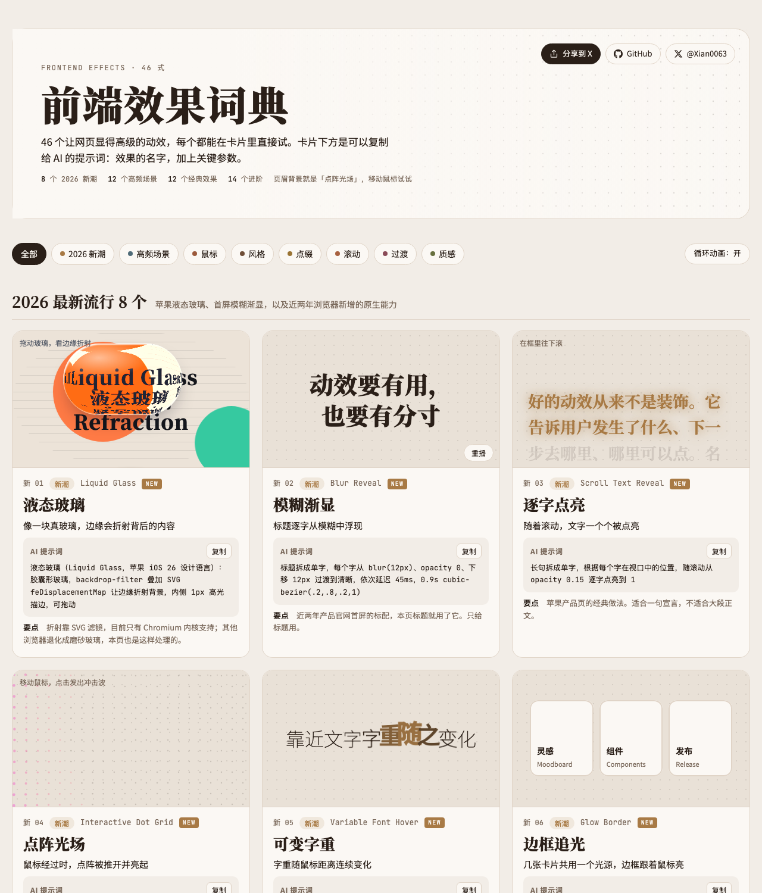

## 能用它做什么

- **找效果**：不知道想要的效果叫什么时，打开页面挨个试，按场景或类别筛选。
- **跟 AI 说清楚**：每个效果都有一条提示词，写明效果名和关键参数（角度、时长、模糊半径、缓动），复制给 Cursor、Claude、ChatGPT 等 AI 编程工具就能做出来。
- **避坑**：每个效果都附一条「要点」，说明适合用在哪、容易踩什么坑。

## 收录的效果

| 分组 | 数量 | 效果 |
|---|---|---|
| 2026 最新流行 | 8 | 液态玻璃、模糊渐显、逐字点亮、点阵光场、可变字重、边框追光、粘滞融合、高度自动过渡 |
| 高频场景 | 12 | 打字机 + 轮换词、连线粒子、程序坞放大、彩纸庆祝、3D 封面流、滚动卡片堆叠、通知动态列表、集成光束图、扫光 / 彩虹 / 脉冲按钮、透视网格 + 流星、进度条 + 主题切换、手绘圈注 |
| 经典 | 12 | 三维倾斜、毛玻璃、流光边框、聚光灯、便当盒布局、乱码解码、磁吸按钮、极光背景、卡片翻转、光标拖尾、新拟态、点击涟漪 |
| 进阶 | 14 | 滚动渐显、视差滚动、吸顶叙事、滚动驱动动画、平滑滚动、错峰入场、数字滚动、页面转场、弹簧动画、文字扫光、无限跑马灯、骨架屏、噪点颗粒、液态变形 |

「高频场景」里的效果参考了 GitHub 上使用最多的动效库：typed.js、particles.js、Swiper、canvas-confetti、Rough Notation、Magic UI、React Bits 等。

## 效果一览

每张图都是该效果最精彩的一刻。打开在线页面可以亲手试。

### 2026 最新流行 · 8

<table>
<tr>
<td width="33%" align="center"> <b>液态玻璃</b> Liquid Glass</td>
<td width="33%" align="center"> <b>模糊渐显</b> Blur Reveal</td>
<td width="33%" align="center"> <b>逐字点亮</b> Scroll Text Reveal</td>
</tr>
<tr>
<td width="33%" align="center"><a href="https://xianxie6.github.io/frontend-effects/#dots">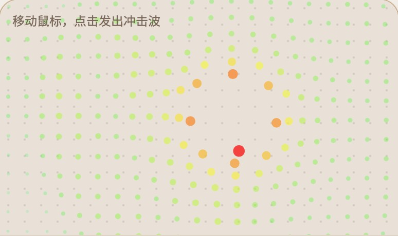</a> <b>点阵光场</b> Interactive Dot Grid</td>
<td width="33%" align="center"> <b>可变字重</b> Variable Font Hover</td>
<td width="33%" align="center"><a href="https://xianxie6.github.io/frontend-effects/#glow">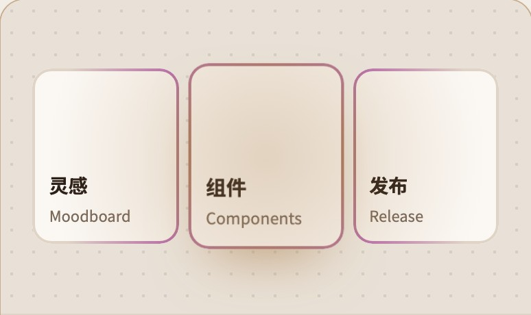</a> <b>边框追光</b> Glow Border</td>
</tr>
<tr>
<td width="33%" align="center"><a href="https://xianxie6.github.io/frontend-effects/#goo">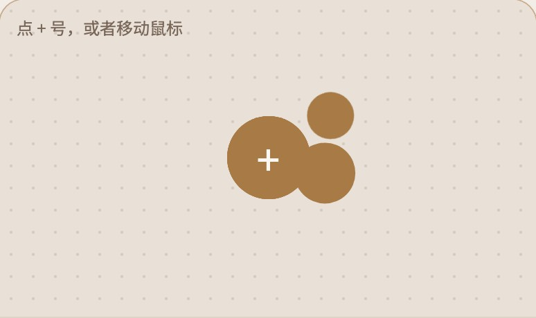</a> <b>粘滞融合</b> Gooey</td>
<td width="33%" align="center"><a href="https://xianxie6.github.io/frontend-effects/#autoh">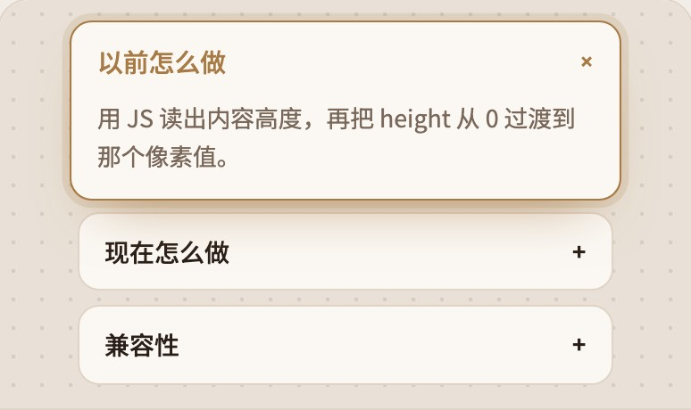</a> <b>高度自动过渡</b> interpolate-size</td>
</tr>
</table>

### 高频场景 · 12

<table>
<tr>
<td width="33%" align="center"> <b>打字机 + 轮换词</b> Typewriter</td>
<td width="33%" align="center"><a href="https://xianxie6.github.io/frontend-effects/#particles">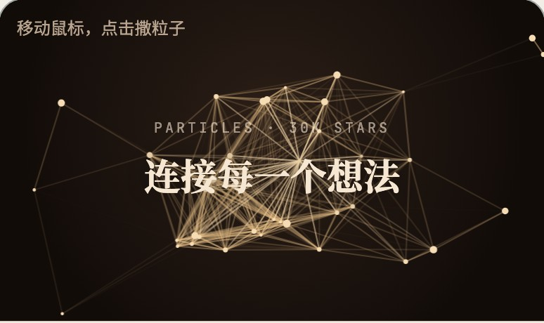</a> <b>连线粒子</b> Particles</td>
<td width="33%" align="center"><a href="https://xianxie6.github.io/frontend-effects/#dock">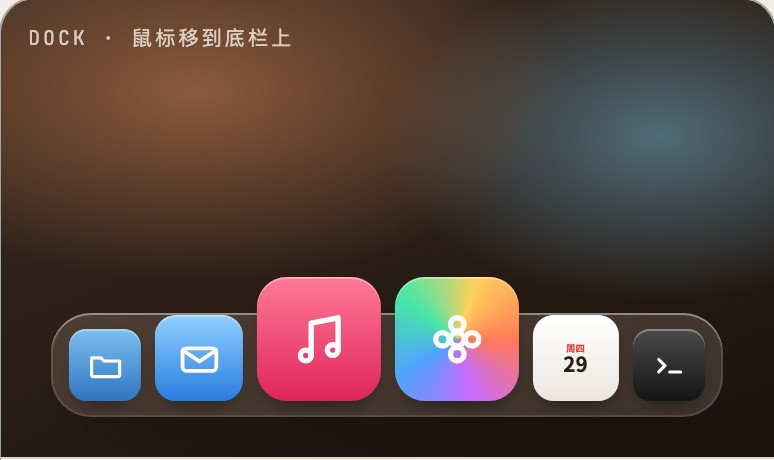</a> <b>程序坞放大</b> Dock</td>
</tr>
<tr>
<td width="33%" align="center"> <b>彩纸庆祝</b> Confetti</td>
<td width="33%" align="center"><a href="https://xianxie6.github.io/frontend-effects/#coverflow">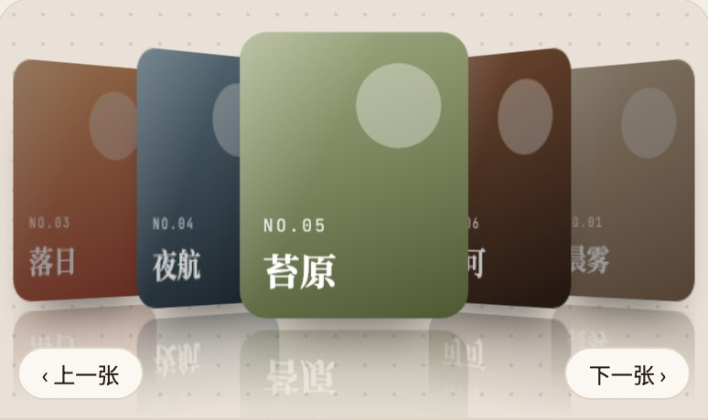</a> <b>3D 封面流</b> Coverflow</td>
<td width="33%" align="center"><a href="https://xianxie6.github.io/frontend-effects/#stack">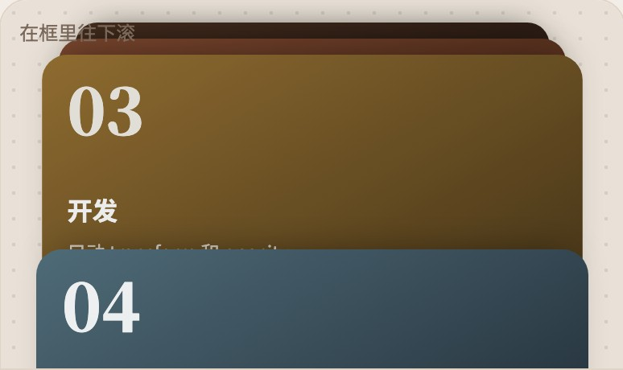</a> <b>滚动卡片堆叠</b> Scroll Stack</td>
</tr>
<tr>
<td width="33%" align="center"><a href="https://xianxie6.github.io/frontend-effects/#alist">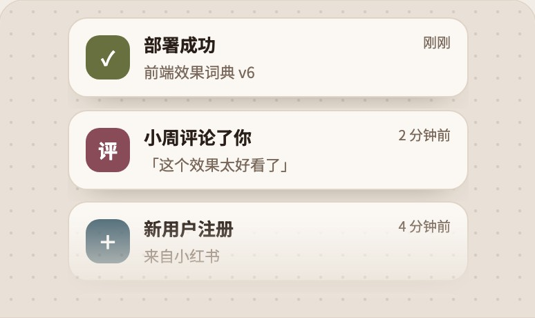</a> <b>通知动态列表</b> Animated List</td>
<td width="33%" align="center"><a href="https://xianxie6.github.io/frontend-effects/#integrate">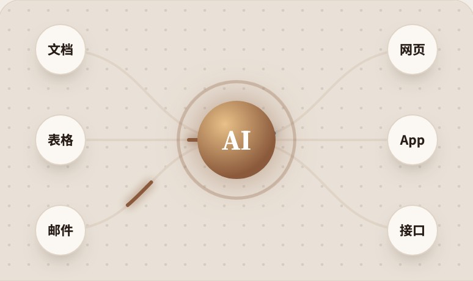</a> <b>集成光束图</b> Animated Beam</td>
<td width="33%" align="center"><a href="https://xianxie6.github.io/frontend-effects/#buttons">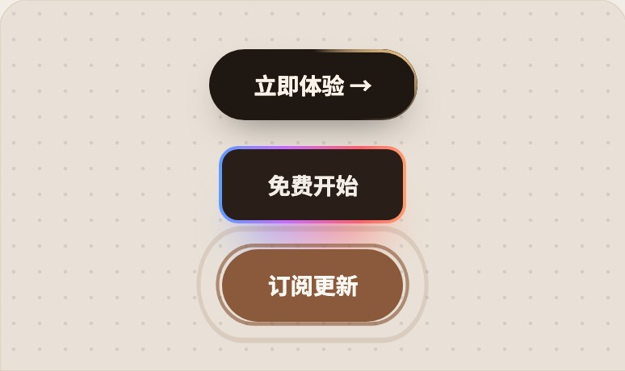</a> <b>扫光 · 彩虹 · 脉冲按钮</b> CTA Buttons</td>
</tr>
<tr>
<td width="33%" align="center"><a href="https://xianxie6.github.io/frontend-effects/#warp">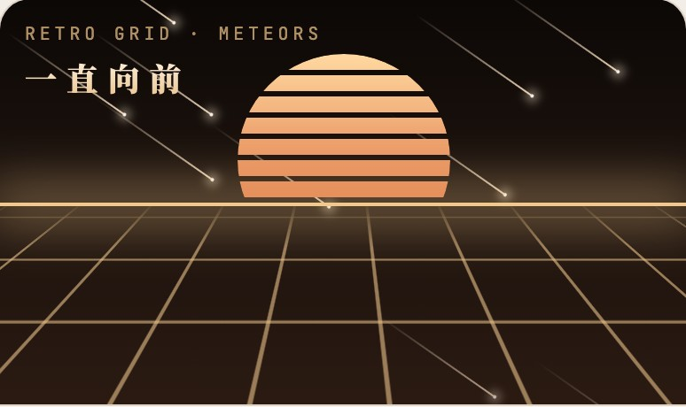</a> <b>透视网格 + 流星</b> Retro Grid</td>
<td width="33%" align="center"><a href="https://xianxie6.github.io/frontend-effects/#progress">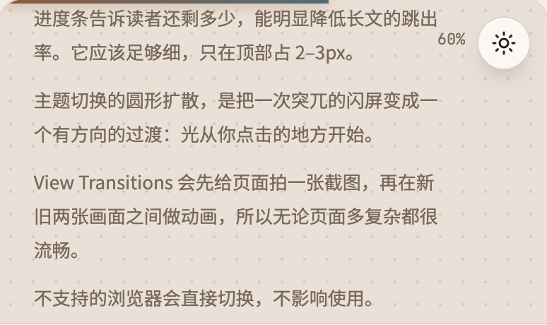</a> <b>进度条 + 主题切换</b> Progress + Theme</td>
<td width="33%" align="center"><a href="https://xianxie6.github.io/frontend-effects/#notation">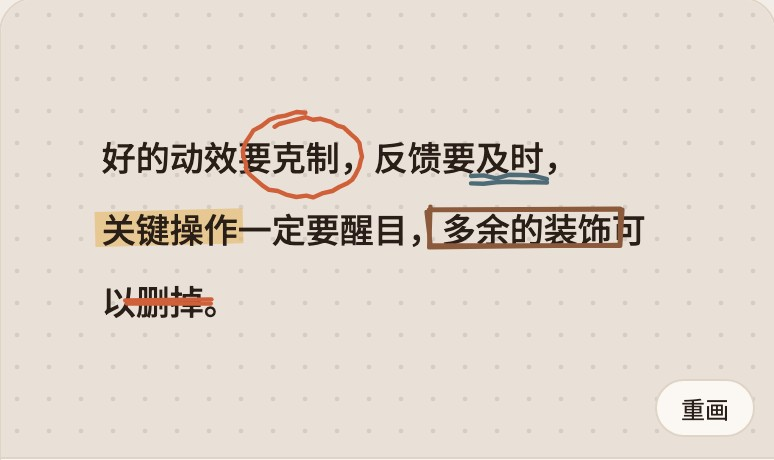</a> <b>手绘圈注</b> Rough Notation</td>
</tr>
</table>

### 经典 · 12

<table>
<tr>
<td width="33%" align="center"> <b>三维倾斜</b> 3D Tilt</td>
<td width="33%" align="center"><a href="https://xianxie6.github.io/frontend-effects/#glass">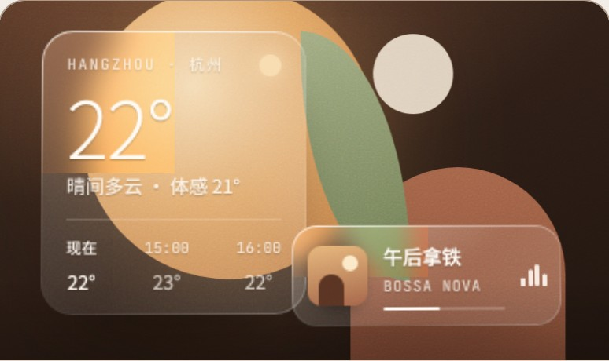</a> <b>毛玻璃</b> Glassmorphism</td>
<td width="33%" align="center"><a href="https://xianxie6.github.io/frontend-effects/#beam">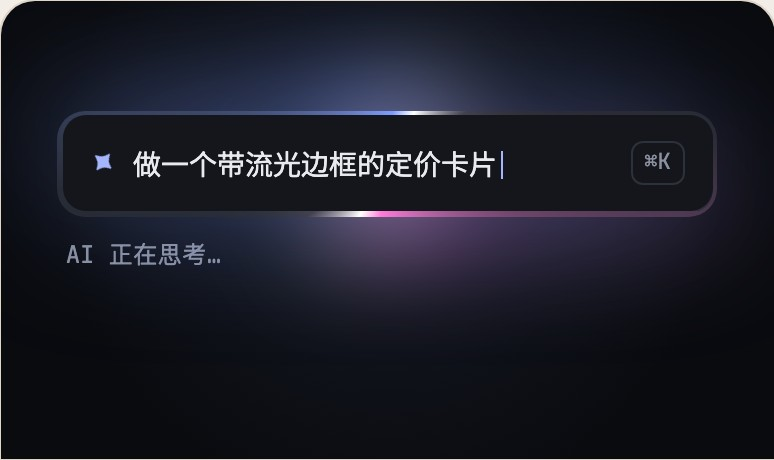</a> <b>流光边框</b> Border Beam</td>
</tr>
<tr>
<td width="33%" align="center"><a href="https://xianxie6.github.io/frontend-effects/#spot">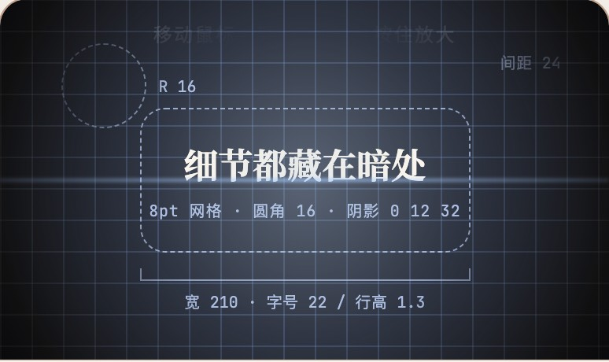</a> <b>聚光灯</b> Spotlight</td>
<td width="33%" align="center"><a href="https://xianxie6.github.io/frontend-effects/#bento">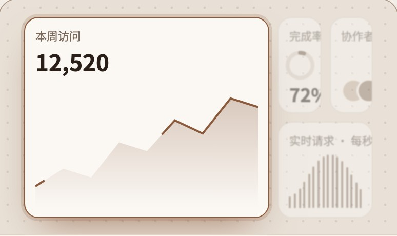</a> <b>便当盒布局</b> Bento Grid</td>
<td width="33%" align="center"><a href="https://xianxie6.github.io/frontend-effects/#scramble">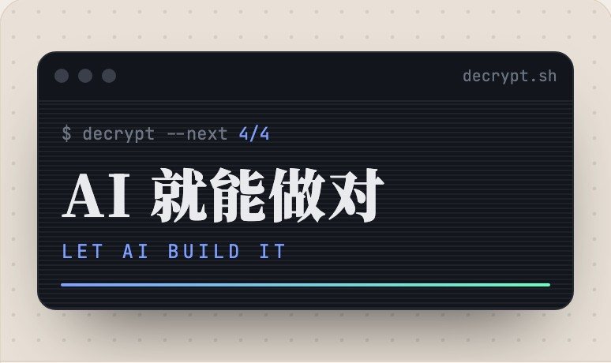</a> <b>乱码解码</b> Text Scramble</td>
</tr>
<tr>
<td width="33%" align="center"><a href="https://xianxie6.github.io/frontend-effects/#magnet">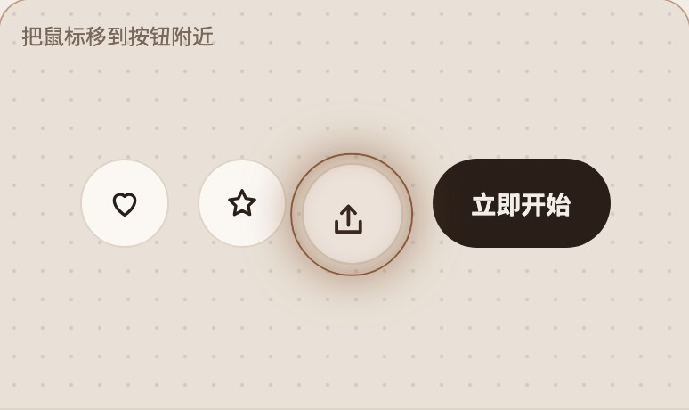</a> <b>磁吸按钮</b> Magnetic</td>
<td width="33%" align="center"> <b>极光背景</b> Aurora</td>
<td width="33%" align="center"><a href="https://xianxie6.github.io/frontend-effects/#flip">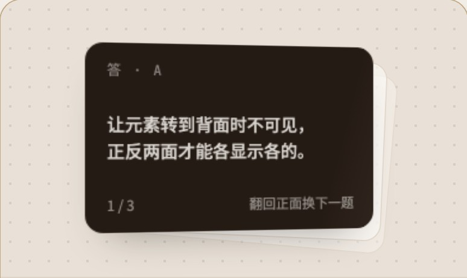</a> <b>卡片翻转</b> Card Flip</td>
</tr>
<tr>
<td width="33%" align="center"><a href="https://xianxie6.github.io/frontend-effects/#trail">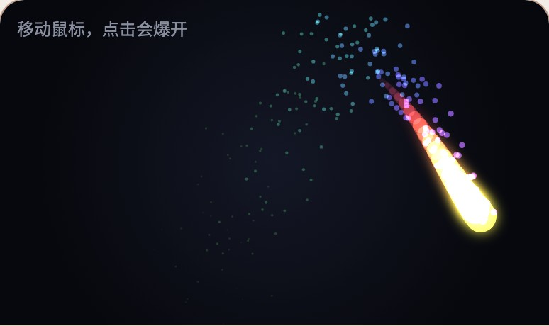</a> <b>光标拖尾</b> Cursor Trail</td>
<td width="33%" align="center"><a href="https://xianxie6.github.io/frontend-effects/#neu">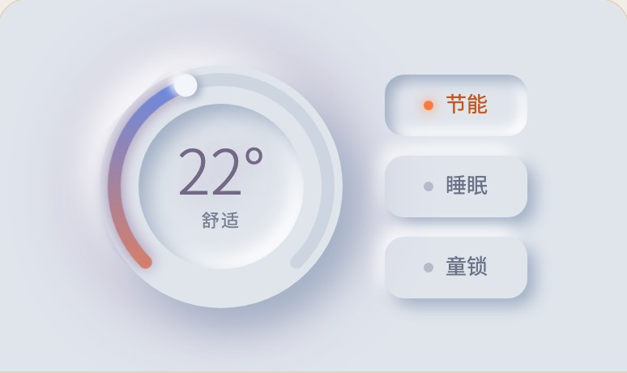</a> <b>新拟态</b> Neumorphism</td>
<td width="33%" align="center"><a href="https://xianxie6.github.io/frontend-effects/#ripple">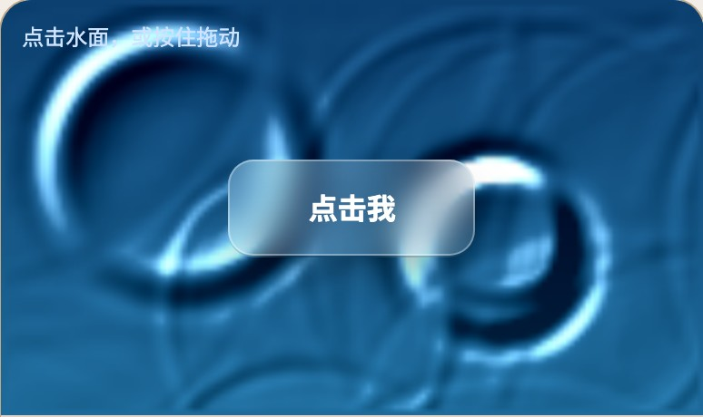</a> <b>点击涟漪</b> Ripple</td>
</tr>
</table>

### 进阶 · 14

<table>
<tr>
<td width="33%" align="center"><a href="https://xianxie6.github.io/frontend-effects/#reveal">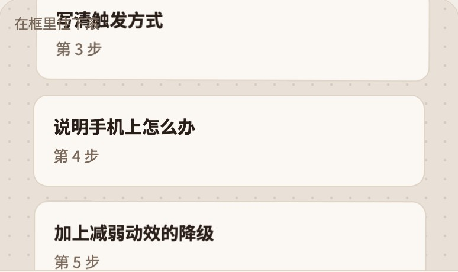</a> <b>滚动渐显</b> Scroll Reveal</td>
<td width="33%" align="center"><a href="https://xianxie6.github.io/frontend-effects/#parallax">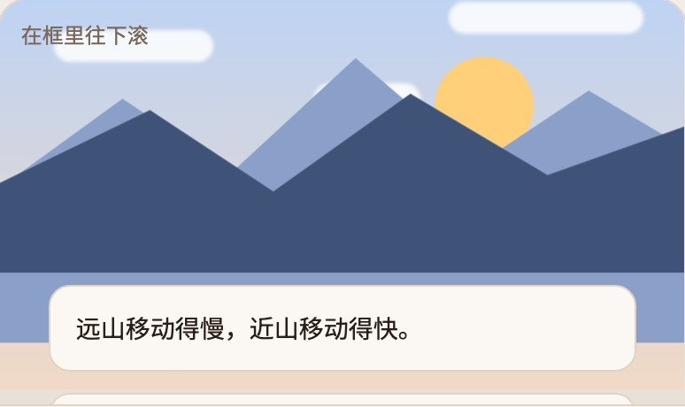</a> <b>视差滚动</b> Parallax</td>
<td width="33%" align="center"><a href="https://xianxie6.github.io/frontend-effects/#sticky">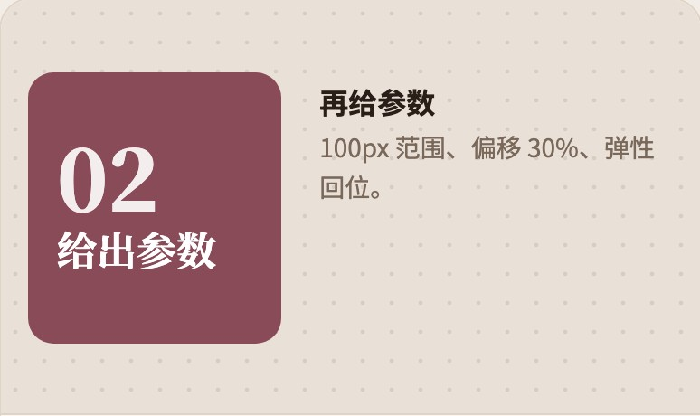</a> <b>吸顶叙事</b> Sticky Scroll</td>
</tr>
<tr>
<td width="33%" align="center"><a href="https://xianxie6.github.io/frontend-effects/#scrolldriven">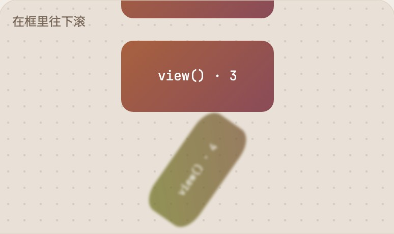</a> <b>滚动驱动动画</b> Scroll-driven Animation</td>
<td width="33%" align="center"><a href="https://xianxie6.github.io/frontend-effects/#smooth">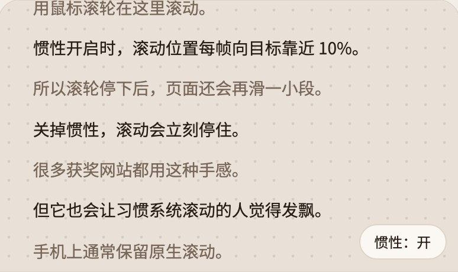</a> <b>平滑滚动</b> Smooth Scroll</td>
<td width="33%" align="center"><a href="https://xianxie6.github.io/frontend-effects/#stagger">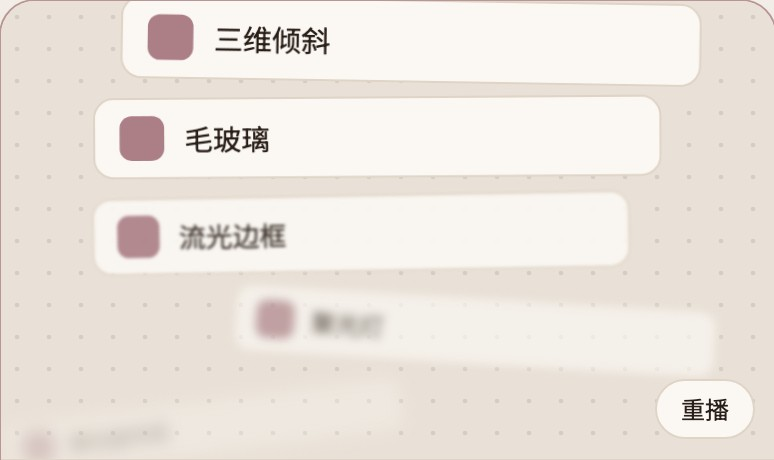</a> <b>错峰入场</b> Stagger</td>
</tr>
<tr>
<td width="33%" align="center"><a href="https://xianxie6.github.io/frontend-effects/#countup">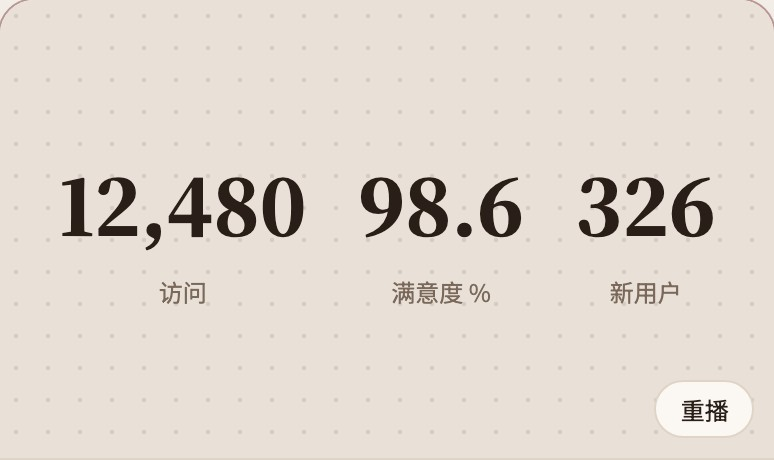</a> <b>数字滚动</b> Count Up</td>
<td width="33%" align="center"> <b>页面转场</b> View Transitions</td>
<td width="33%" align="center"><a href="https://xianxie6.github.io/frontend-effects/#spring">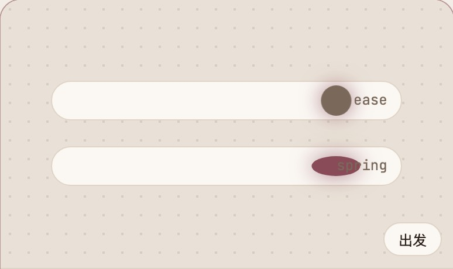</a> <b>弹簧动画</b> Spring</td>
</tr>
<tr>
<td width="33%" align="center"> <b>文字扫光</b> Shimmer Text</td>
<td width="33%" align="center"><a href="https://xianxie6.github.io/frontend-effects/#marquee">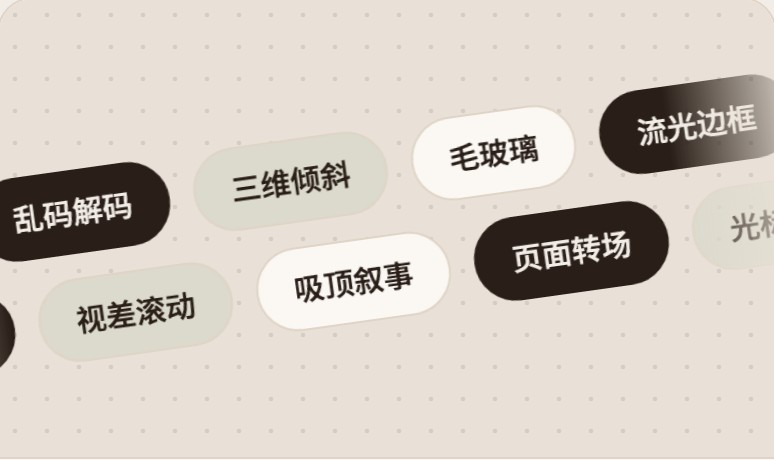</a> <b>无限跑马灯</b> Marquee</td>
<td width="33%" align="center"><a href="https://xianxie6.github.io/frontend-effects/#skeleton">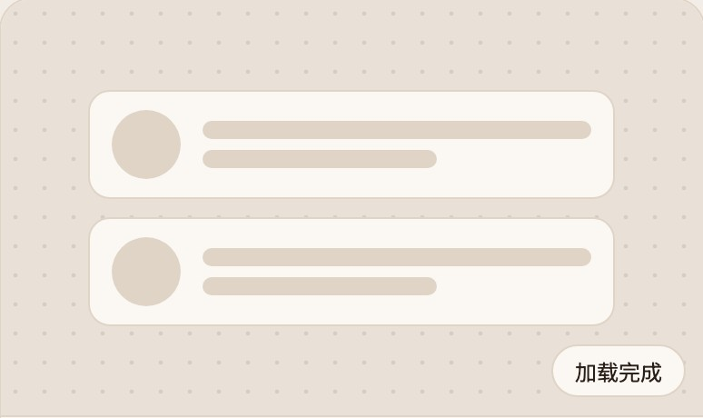</a> <b>骨架屏</b> Skeleton</td>
</tr>
<tr>
<td width="33%" align="center"> <b>噪点颗粒</b> Grain</td>
<td width="33%" align="center"><a href="https://xianxie6.github.io/frontend-effects/#blob">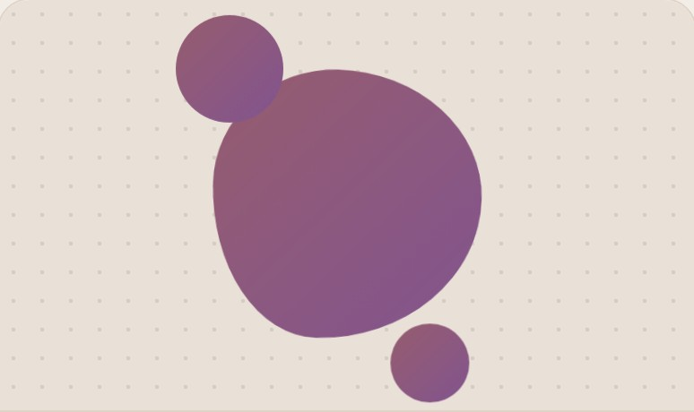</a> <b>液态变形</b> Blob Morph</td>
</tr>
</table>

## 使用方式

**在线使用**：直接打开上面的链接。

**本地使用**：下载 `index.html`，双击用浏览器打开即可。整个项目只有这一个文件，没有依赖，不需要安装和构建。

**复制效果代码**：所有效果都是原生 HTML / CSS / JavaScript 写的，没有用任何框架。在浏览器里右键「检查」就能看到对应的代码，按卡片的 id（如 `#tilt`、`#dock`）搜索即可找到。

## 浏览器支持

推荐使用最新版 Chrome、Edge 或 Safari。少数效果用到了较新的浏览器能力，不支持时会自动退化，不影响其他效果：

| 效果 | 需要的能力 | 不支持时 |
|---|---|---|
| 液态玻璃的边缘折射 | `backdrop-filter` + SVG 滤镜（仅 Chromium 内核） | 退化为磨砂玻璃 |
| 滚动驱动动画 | `animation-timeline`（Chrome 115+、Safari 26+） | 显示静态版本 |
| 高度自动过渡 | `interpolate-size`（Chrome 131+） | 直接展开 |
| 页面转场、主题切换扩散 | View Transitions API | 直接切换 |

## 其他

- 支持浅色和深色两种主题，跟随系统设置。
- 页面右上角的「循环动画」按钮可以暂停所有循环动画；系统开启「减弱动态效果」时默认暂停。
- 动效较多，配置较低的电脑上如果卡顿，可以先暂停循环动画。

## 许可证

[MIT](LICENSE)
